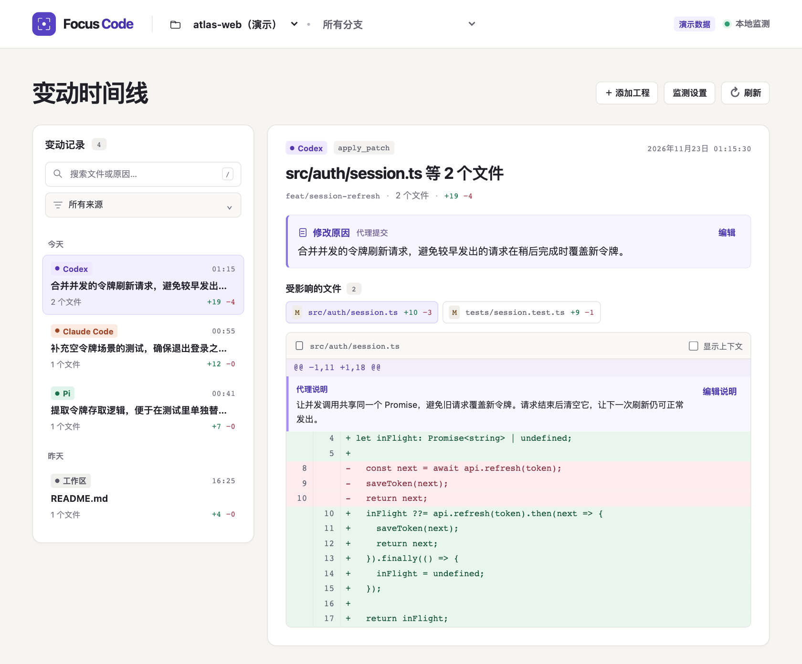

# Focus Code

[简体中文](./README.md) · **English**

Focus Code is a **code change review plugin for coding agents**. After Claude Code, Codex, or Pi edits a project, open one local view to see which files changed, which lines were added or removed, and why the agent made the edit.

## Quick start with Claude Code

1. Install Focus Code and its Claude Code integration from your terminal.

   ```sh
   npm install -g focus-code
   focus-code install claude --global
   ```

2. Start a new Claude Code session in a Git project. After Claude makes an edit, open the project's timeline **from Claude Code**.

   ```text
   /focus-code show
   ```

You can also run `focus-code show` in a regular terminal, or use `focus-code demo` to try it with sample changes. [Set up another agent](#client-integrations)

Requires Node.js 22.13+ and Git on macOS or Linux.

## Review one change



In this example, Codex makes concurrent token refresh calls share one request. Open its timeline entry to see the exact changes in `session.ts` and the reason for sharing the request.

- **Find the edit.** The timeline shows live edits alongside committed records. Filter by branch or source. A `HEAD` badge marks an uncommitted change.
- **Inspect the implementation.** Review added and removed lines file by file and reveal surrounding context when needed.
- **Understand the reason.** Read the overall reason and section notes beside the diff, or add your own notes.

Your change history is stored locally.

## Browser and project settings

Open the viewer directly from a regular terminal.

```sh
focus-code show
```

Run it in a Git project to select its worktree automatically. Run it from any other directory to open the viewer and choose a registered project from the dropdown. To open a particular project directly, you can optionally pass its path with `focus-code show /path/to/repo`.

While viewing a parent project, Focus Code searches for nested Git worktrees within a bounded directory scan, including independent repositories ignored by the parent and initialized Git submodules. They appear as separate projects in the dropdown. Select one to see uncommitted changes against its own HEAD. If a worktree is not found, run `focus-code show /path/to/child`. Each worktree has its own history.

Use the globe icon to switch between Simplified Chinese and English, or the theme icon to choose Light, Dark, or Auto. Auto follows the system theme. The browser remembers your choices.

Tracking is on by default. In **监测设置** (Tracking settings), you can change the global default or override it for the current project. With a demo project selected, these controls apply to the demo data.

<details>
<summary>Tracking settings, project selection, and filters</summary>

| Control | Options | Default and behavior |
| --- | --- | --- |
| Top bar → Language and Theme | Interface language and theme | Simplified Chinese and Auto by default. The language setting applies to interface text and generated summaries. Saved reasons and explanations retain their original wording. |
| **监测设置** (Tracking settings) → **全局默认** (Global default) | On or off | On. Applies to every project that inherits the global default, including newly discovered projects. |
| **监测设置** → Current project | Inherit the global default, always on, or always off | Inherit. A project override takes precedence over the global default and is stored by Git worktree root. |
| Project and branch selectors | Select a project, follow its current Git branch, or manually select all branches or a single branch | Opening or switching worktrees follows the selected worktree's current Git branch by default. Records are filtered by the branch at capture time. The list includes local branches and branches with saved history. |
| Timeline date, source, and search | Filter by date, client, file path, reason, or explanation. | All dates and sources by default. Dates use the browser’s local time. Custom ranges include both dates; the last two days are yesterday and today. |
| Diff context | Show or hide unchanged lines around a changed section | Shown by default. |

Unreviewed cards have a dot. A card is dimmed after you open it and its diff loads. Review status is saved per browser and worktree; a new revision of an uncommitted diff is unreviewed.

Use the switch next to the card-list heading to choose **Cumulative diff** or **Edit history**. Edit history is the default. Cumulative diff summarizes one file per card against `HEAD`; Edit history shows one card per recorded operation, including repeated edits to the same file. A captured file deletion appears as a new card labeled **File deleted**, with a diff of what was removed. Earlier cards stay in Edit history. The two views track review status independently. Recorded operations that exactly match a recent merge against its first parent stay visible with a `MERGE` badge.

- To exclude one project, keep tracking on globally and set that project to always off.
- To track only selected projects, turn tracking off globally and set each chosen project to always on.

Pausing tracking also pauses new records, the live view of uncommitted diffs, and agent prompts for explanations. Existing history remains available for browsing, searching, and manual edits. Resuming uses the current files as a new tracking baseline. Settings apply to the viewer and agents using the same data directory.

</details>

### Data management

Open **Data management** above the timeline to see the total record count and storage usage, including a breakdown by repository (Git worktree). Expand a repository to see record counts by branch. Usage is the size of each SQLite database and its WAL/shared-memory files, including the snapshots used for tracking.

You can clear saved history for all repositories, a single repository, or one branch. Use **Delete** at the right of a repository or branch row, then confirm or cancel in that row. Repositories with no saved history move to a collapsed group where you can still inspect their storage usage. Confirming permanently removes the selected diffs, reasons, and section explanations, and attempts to compact the database. Cleanup leaves Git, working files, and tracking settings untouched. Live diffs may still appear, and new edits can still be recorded.

**Save and restore history:** Use **Save history** on a repository or branch row to download a `.focus-history.json` file. It contains saved diffs, reasons, and section notes, but no tracking snapshots, Git objects, or session IDs. Review the contents before sharing. Each archive is limited to 32 MiB; export one branch at a time for larger histories.

Receivers import the file from **Data management → Restore history**. By default it opens as a standalone review archive, with no checkout needed. You can also merge into a local worktree; existing records and working files aren't overwritten, and duplicate records are skipped. Imported archives remain available in the project picker.

## Command-line options

<details>
<summary>Startup flags, port selection, and installation scope</summary>

| Command | Options | Behavior |
| --- | --- | --- |
| `focus-code watch [repository]` | `--port <port>`, `--no-open` | Starts the tracking service and browser view. Without a path, it opens the current Git worktree when available. |
| `focus-code demo` | `--port <port>`, `--no-open` | Starts a viewer with sample changes. |
| `focus-code show [repository]` | `--no-open` | Opens the viewer. The path is optional. From a Git worktree, the command selects that project automatically. Reuses a running viewer for the same data directory or starts one on demand. |
| `focus-code install <client> --global` | `--global` | Installs the integration for the current user. Restart the client afterward. |
| `focus-code install <client> <repository>` | Git worktree path | Installs only for that project. Use `all` to install every supported project-level integration. |

`watch` and `demo` try `4317` first, then `4318`, then ask the OS for a free port. `--port 0` asks the OS for a free port immediately. Use `--port <1–65535>` to specify an addressable port. If your chosen port is in use, choose another port or omit the option for automatic selection. The viewer binds to `127.0.0.1` and prints its actual address. Use `--no-open` to start the service or print its link without launching a browser.

```sh
focus-code watch /path/to/repo --port 4500
focus-code watch --port 0 --no-open
focus-code show --no-open
```

With neither `--global` nor a repository path, Claude Code, OpenCode, Gemini CLI, and TRAE Desktop install for the current user. Codex, Pi, and `all` use the current Git worktree. TRAE CLI uses a user-level plugin installation.

</details>

## Environment variables and data directory

<details>
<summary>Client paths, a custom data directory, and SQLite files</summary>

| Variable | Used for | Default and precedence |
| --- | --- | --- |
| `FOCUS_HOME` | Full path to the Focus Code data directory | Takes precedence over `XDG_STATE_HOME`. |
| `XDG_STATE_HOME` | System state directory | With no `FOCUS_HOME`, uses `$XDG_STATE_HOME/focus-code`. With neither variable, uses `~/.local/state/focus-code/`. |
| `CLAUDE_CONFIG_DIR` | Claude Code user configuration | Defaults to `~/.claude`. Installs hooks in `settings.json` and the skill in `skills/focus-code/SKILL.md`. |
| `CODEX_HOME` | Codex user configuration | Defaults to `~/.codex`. Global hooks are installed in `hooks.json`. The viewer skill is installed in `~/.agents/skills/focus-code/`. |
| `PI_CODING_AGENT_DIR` | Pi user configuration | Defaults to `~/.pi/agent`. The global extension is installed in `extensions/focus-code.ts`. |
| `OPENCODE_CONFIG_DIR` | OpenCode user configuration | Takes precedence over `XDG_CONFIG_HOME`. The plugin is installed in `plugins/focus-code.js`. |
| `XDG_CONFIG_HOME` | System configuration directory for OpenCode | With no `OPENCODE_CONFIG_DIR`, uses `$XDG_CONFIG_HOME/opencode`. With neither variable, uses `~/.config/opencode`. |
| `GEMINI_CLI_HOME` | Home directory used by Gemini CLI | Defaults to `~`. The global integration is installed in `.gemini/settings.json` under that directory. |
| `TRAECLI_BIN` | TRAE CLI executable, as a path or command name | Searches `PATH` for `traex`, then `traecli`, then `trae-cli` by default. |
| `TRAE_PROJECT_DIR` | TRAE project directory | Provided by TRAE and used when the hook does not provide a working directory. |

The viewer, agent process, and hooks need the same `FOCUS_HOME` or `XDG_STATE_HOME` setting. Each data directory has its own project list and history.

```sh
export FOCUS_HOME="$HOME/.local/state/focus-code-work"
focus-code watch /path/to/repo --no-open
```

| Entry in the data directory | Contents |
| --- | --- |
| `projects.sqlite` | Discovered projects and the local viewer address. |
| `tracking.sqlite` | Global tracking default and per-project overrides. |
| `<worktree-path-hash>/journal.sqlite` | File snapshots, diffs, reasons, and section-level explanations. |
| `integrations/trae-cli/` | Local plugin and marketplace files for TRAE CLI. |

</details>

## Client integrations

### Global installation

Run the command for your client once, then restart the client.

| Client | Installation | Default configuration path |
| --- | --- | --- |
| Claude Code | `focus-code install claude --global` | `~/.claude/settings.json` and `~/.claude/skills/focus-code/SKILL.md` |
| Codex | `focus-code install codex --global` | `~/.codex/hooks.json`. Review and trust the hooks in `/hooks`. |
| OpenCode | `focus-code install opencode --global` | `~/.config/opencode/plugins/focus-code.js` |
| Gemini CLI | `focus-code install gemini --global` | `~/.gemini/settings.json` |
| Pi | `focus-code install pi --global` | `~/.pi/agent/extensions/focus-code.ts` |
| TRAE Desktop | `focus-code install trae --global` | `~/.trae/hooks.json` and `~/.trae-cn/hooks.json` when `~/.trae-cn` exists |
| TRAE CLI | `focus-code install trae-cli --global` | Installs `focus-code@focus-code-local` through the TRAE CLI plugin manager. |

A worktree appears in the viewer after the integration captures its first change. Hooks can record edits and explanations while the viewer is closed. Follow your client's trust prompts when opening a new workspace in Claude Code or Gemini CLI.

### TRAE setup

- **Desktop**. In **Settings → Hooks**, select **Global**, enable **Configured Hooks**, and select **Run Automatically Locally** to allow hooks to write the local history. Select **Project** for a project-level installation.
- **CLI**. Use a `traex` or `traecli` version that supports plugins and `/hooks`. Review and trust Focus Code in `/hooks` after installation. You can set `TRAECLI_BIN` to point to your executable. Use the client plugin manager to uninstall `focus-code@focus-code-local`.

### Project-level installation

Replace `/path/to/repo` with the Git worktree your agent uses.

| Client | Installation | Project configuration |
| --- | --- | --- |
| Claude Code | `focus-code install claude /path/to/repo` | `.claude/settings.local.json` and `.claude/skills/focus-code/SKILL.md` |
| Codex | `focus-code install codex /path/to/repo` | `.codex/hooks.json`. Review and trust the hooks in `/hooks`. |
| Pi | `focus-code install pi /path/to/repo` | `.pi/extensions/focus-code.ts`. Follow Pi's project extension trust prompts. |
| OpenCode | `focus-code install opencode /path/to/repo` | `.opencode/plugins/focus-code.js` |
| Gemini CLI | `focus-code install gemini /path/to/repo` | `.gemini/settings.json` in a trusted worktree. |
| TRAE Desktop | `focus-code install trae /path/to/repo` | `.trae/hooks.json`. Enable the project hook configuration in **Settings → Hooks**. |

`focus-code install all /path/to/repo` installs all integrations listed in this table for that worktree.

### Upgrade and uninstall

Run `focus-code update` to upgrade a verified global npm installation. To show the installed version, the latest public npm version, and the installation source without installing anything, run `focus-code update --check`. Local builds, links, and unverified installations are never overwritten. Restart the viewer and any active clients to load the new code.

If your version does not have the update command, use `npm install -g focus-code@latest --registry=https://registry.npmjs.org/` to upgrade a global npm installation manually. The installer merges existing JSON settings and can be run again. If Focus Code or Node moves to a different path, rerun the relevant installer and remove any Focus Code hooks that reference the previous path.

To remove an integration, remove the Focus Code hook entries that invoke `src/cli.js hook` and any generated Claude Code or Codex `focus-code` skill directories. For Pi or OpenCode, remove the generated extension entry. Use the TRAE CLI plugin manager for that client. Run `npm uninstall -g focus-code` to remove the command-line package. The data directory retains its history.

## How changes are recorded

<details>
<summary>Snapshots, explanations, and tracking coverage</summary>

- The timeline updates about every 0.8 seconds while the page is visible. Edits relative to Git HEAD get a `HEAD` badge and can appear while an agent tool is still running. Committing an edit removes it from Cumulative diff. A revert or deletion that leaves no net change removes the card only from Cumulative diff; captured operations remain in Edit history. The worktree scan runs about every 1.5 seconds and uses the first scan as a baseline.
- Pi's global or project extension records its tool activity. Start a new Pi session after installation or an update, or use `/reload` in an open session. Attribution to Pi requires a captured tool event.
- The agent can submit an overall reason before editing with `: # focus-reason: explain the goal of this edit`. After the edit, the hook gives the agent the changed section IDs and lets it fill in a missing overall reason alongside section explanations with `: # focus-explain: {"change":42,"reason":"Prevent null values from reaching the cache","notes":[[0,0,"Validate the input before it reaches the cache"]]}`. Each note contains the zero-based file index, zero-based section index, and explanation.
- Records with no overall reason show excerpts from saved section notes or an overview generated from the actual diff, with the source labeled in the viewer. Each diff section shows an agent explanation, a manual entry, or a summary. Summaries use nearby code and calls in the same file to explain effects the code supports, such as reusing an extracted helper or avoiding an error when a value is missing. With limited context, the summary describes the concrete edit. A manual entry takes precedence over later agent submissions.
- Overlapping tools in one session are grouped. Edits made by overlapping sessions are shown with an unknown source. Multiple changes inside a sampling interval can be grouped, and transient changes can be missed between samples.
- Built-in file edits in Claude Code, OpenCode, Gemini CLI, and TRAE are recorded in the worktree containing the edited file. Shell commands are tracked from the hook's working directory or the tool's explicit working directory. A shell command writing to another worktree requires that worktree to be monitored separately to capture the edit.
- Binary files and files larger than 256 KiB are recorded as metadata. Local SQLite databases hold the tracking state and history.

</details>

## Development

Run `npm ci` to install dependencies, `npm test` to test repository tracking and the viewer API, or `npm run demo` to start the demo from source. Use `node src/cli.js` for other commands from the source tree.
