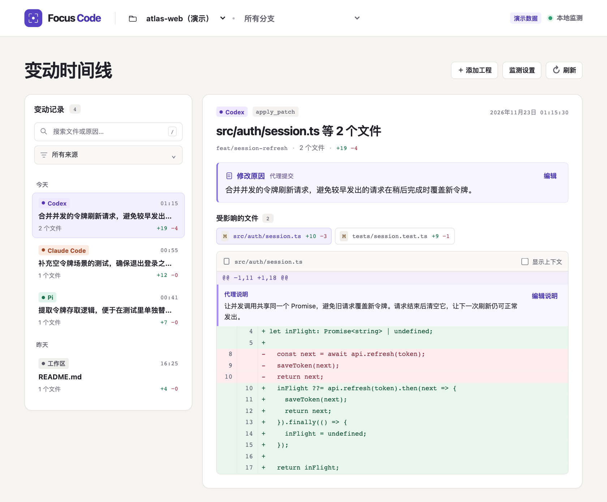

# Focus Code

**简体中文** · [English](./README.en.md)

Focus Code 是一个 **coding agent 的代码变动审阅插件**。让 Claude Code、Codex 或 Pi 改完代码后，在一个本地网页里确认它动了哪些文件、具体改了哪几行、为什么改。

## 用 Claude Code 快速开始

1. 在终端安装 Focus Code，并接入 Claude Code。

   ```sh
   npm install -g focus-code
   focus-code install claude --global
   ```

2. 在 Git 工程中新开 Claude Code 会话。让 Claude 完成一次修改，再在 **Claude Code 输入框**里打开当前工程的时间线。

   ```text
   /focus-code show
   ```

也可以用 `focus-code show` 从普通终端打开网页，或用 `focus-code demo` 先体验示例。[接入其他 agent](#客户端集成)

需要 Node.js 22.13+ 和 Git，支持 macOS 和 Linux。

## 看一条实际改动



示例中，Codex 让并发的令牌刷新调用共享同一个请求。选中这条记录，就能看到 `session.ts` 实际删掉和新增的代码，以及为什么要这样处理并发调用。

- **定位改动**。在同一条时间线中查看实时变动和已提交记录，按分支或来源筛选。带 `HEAD` 标签的卡片仍未提交。
- **检查实现**。逐个文件审阅增删行，需要时展开上下文。
- **弄清理由**。在 diff 旁查看整体原因和逐段说明，也可以自己补写。

变动历史保存在本机。

## 网页与项目配置

从普通终端也可以直接运行这条命令。

```sh
focus-code show
```

在 Git 工程中运行时，会自动选中当前工作树。在其他目录运行时，会打开同一个网页，可以用顶部下拉框选择已登记的工程。想直接打开指定工程时，可以加上可选路径 `focus-code show /path/to/repo`。

要登记新工程，可以在网页点「添加工程」并输入 Git 工作树的绝对路径。每个工作树独立保存历史。

右上角的「界面设置」提供简体中文和 English，以及亮色、暗色和自动主题。自动主题跟随系统，选择保存在当前浏览器。

默认监测所有跟随全局设置的工程。点「监测设置」可以修改全局默认，也可以为当前工程单独开启或关闭。选中演示工程时也能操作，设置只作用于演示数据。

<details>
<summary>监测设置、工程切换与筛选</summary>

| 位置 | 可配置项 | 默认值与作用 |
| --- | --- | --- |
| 右上角 → 界面设置 | 界面语言与主题 | 默认简体中文、自动主题。语言适用于界面和自动摘要，已有修改原因与说明保留原文。 |
| 右上角 → 监测设置 → 全局默认 | 默认开启监测、默认关闭监测 | 默认开启。影响所有设为「跟随全局默认」的工程，包括之后发现的工程。 |
| 右上角 → 监测设置 → 当前工程 | 跟随全局默认、单独开启、单独关闭 | 默认跟随全局。单独开启和单独关闭优先于全局默认，按 Git 工作树根目录保存。 |
| 顶部 → 工程、分支 | 选择工程、所有分支或单个分支 | 分支默认选「所有分支」。记录按写入时的分支筛选，本地分支和已有历史的分支都可选。 |
| 时间线 → 来源和搜索 | 按客户端或工作区来源筛选，按文件路径、原因或说明搜索 | 默认所有来源，搜索为空。可以与分支筛选一起使用。 |
| diff → 显示上下文 | 显示或隐藏代码段周围的上下文行 | 默认显示。 |

- 想排除单个工程时，保持全局默认开启，选中该工程并设为「单独关闭」。
- 想只监测指定工程时，把全局改为默认关闭，再添加或选中对应工程并设为「单独开启」。

关闭监测会暂停新记录、未提交 diff 的实时展示和代理原因提示。已保存的历史 diff 和说明仍可查看、搜索和手动编辑。重新开启后会以当前文件内容作为记录的新基线。监测设置适用于当前机器上使用同一数据目录的网页服务和代理。

</details>

## 命令行配置

<details>
<summary>启动参数、端口与安装范围</summary>

| 命令 | 可用参数 | 行为 |
| --- | --- | --- |
| `focus-code watch [仓库路径]` | `--port <端口>`、`--no-open` | 持续监测并启动网页。路径省略时优先打开当前 Git 工作树，也可在网页选择已登记工程。 |
| `focus-code demo` | `--port <端口>`、`--no-open` | 打开示例记录。 |
| `focus-code show [仓库路径]` | `--no-open` | 打开网页。路径可以省略，此时在 Git 工程中运行会自动选中当前工作树。服务尚未启动时会按需启动。 |
| `focus-code install <客户端> --global` | `--global` | 为当前系统用户安装客户端集成。安装后重启客户端。 |
| `focus-code install <客户端> <仓库路径>` | Git 工作树路径 | 只为指定 Git 工程安装集成。`all` 可一次安装所有支持按工程配置的客户端。 |

`watch` 和 `demo` 默认依次尝试 `4317`、`4318`，再请系统分配一个空闲端口。`--port 0` 直接使用系统分配的空闲端口，`--port <1–65535>` 使用指定端口。指定端口被占用时可以换一个值，也可以省略参数让程序自动选择。实际地址以终端输出为准，网页服务监听 `127.0.0.1`。`--no-open` 适合只启动服务或打印链接。

```sh
focus-code watch /path/to/repo --port 4500
focus-code watch --port 0 --no-open
focus-code show --no-open
```

不传 `--global` 和仓库路径时，Claude Code、OpenCode、Gemini CLI 和 TRAE 桌面端使用用户级安装。Codex、Pi 和 `all` 使用当前 Git 工作树。TRAE CLI 使用用户级插件安装。

</details>

## 环境变量与数据目录

<details>
<summary>客户端路径、自定义数据目录与 SQLite 文件</summary>

| 环境变量 | 用途 | 默认值与优先级 |
| --- | --- | --- |
| `FOCUS_HOME` | 指定 Focus Code 的完整数据目录 | 优先于 `XDG_STATE_HOME`，未设置时使用下方默认路径。 |
| `XDG_STATE_HOME` | 通过系统状态根目录设置 Focus Code 数据位置 | `FOCUS_HOME` 未设置时，使用 `$XDG_STATE_HOME/focus-code`。两者均未设置时使用 `~/.local/state/focus-code/`。 |
| `CLAUDE_CONFIG_DIR` | Claude Code 的用户配置目录 | 默认 `~/.claude`。安装 `settings.json` 中的 hooks 和 `skills/focus-code/SKILL.md`。 |
| `CODEX_HOME` | Codex 的用户配置目录 | 默认 `~/.codex`。全局 hooks 写入其中的 `hooks.json`。Codex 的打开记录技能位于 `~/.agents/skills/focus-code/`。 |
| `PI_CODING_AGENT_DIR` | Pi 的用户配置目录 | 默认 `~/.pi/agent`。全局扩展写入 `extensions/focus-code.ts`。 |
| `OPENCODE_CONFIG_DIR` | OpenCode 的用户配置目录 | 优先于 `XDG_CONFIG_HOME`。全局插件写入 `plugins/focus-code.js`。 |
| `XDG_CONFIG_HOME` | OpenCode 的系统配置根目录 | `OPENCODE_CONFIG_DIR` 未设置时使用 `$XDG_CONFIG_HOME/opencode`。两者均未设置时使用 `~/.config/opencode`。 |
| `GEMINI_CLI_HOME` | Gemini CLI 配置所用的用户主目录 | 默认 `~`，全局配置写入其下的 `.gemini/settings.json`。 |
| `TRAECLI_BIN` | 指定 TRAE CLI 的可执行文件路径或命令名 | 默认在 `PATH` 依次查找 `traex`、`traecli`、`trae-cli`。 |
| `TRAE_PROJECT_DIR` | TRAE 提供的工程目录 | 由客户端传给 hook，在 hook 缺少工作目录时作为回退。 |

网页服务、客户端进程和 hooks 需要看到同一份 `FOCUS_HOME` 或 `XDG_STATE_HOME` 设置。切换数据目录会打开该目录自己的工程列表和历史。

```sh
export FOCUS_HOME="$HOME/.local/state/focus-code-work"
focus-code watch /path/to/repo --no-open
```

| 数据目录中的文件 | 内容 |
| --- | --- |
| `projects.sqlite` | 已发现的工程和本地网页服务的位置。 |
| `tracking.sqlite` | 全局监测默认值和各工程的覆盖设置。 |
| `<工作树路径哈希>/journal.sqlite` | 工程快照、diff、修改原因和代码段说明。 |
| `integrations/trae-cli/` | TRAE CLI 使用的本地插件和市场清单。 |

</details>

## 客户端集成

### 全局安装

Claude Code、Codex、OpenCode、Gemini CLI、Pi、TRAE 桌面端和 TRAE CLI 支持全局安装。选择对应命令运行一次，随后重启客户端。

| 客户端 | 安装命令 | 默认配置位置 |
| --- | --- | --- |
| Claude Code | `focus-code install claude --global` | `~/.claude/settings.json` |
| Codex | `focus-code install codex --global` | `~/.codex/hooks.json`，在 `/hooks` 审阅并信任 Focus Code |
| OpenCode | `focus-code install opencode --global` | `~/.config/opencode/plugins/focus-code.js` |
| Gemini CLI | `focus-code install gemini --global` | `~/.gemini/settings.json` |
| Pi | `focus-code install pi --global` | `~/.pi/agent/extensions/focus-code.ts` |
| TRAE 桌面端 | `focus-code install trae --global` | `~/.trae/hooks.json`，已存在 `~/.trae-cn` 时也会写入该目录的 `hooks.json` |
| TRAE CLI | `focus-code install trae-cli --global` | 通过 `traex`、`traecli` 或 `trae-cli` 的插件命令安装 `focus-code@focus-code-local` |

在本地 Git 工作树中使用任一已接入的客户端，首次捕获到修改时，该工程会自动出现在网页顶部列表。网页关闭期间，插件也会把变动和代理提交的原因写入本机历史。使用 Claude Code 或 Gemini CLI 打开新工程时，按客户端提示信任该工程。

#### 在客户端里打开记录页

安装或升级后启动一个新会话。Codex 需要先在 `/hooks` 审阅并信任 Focus Code。首次记录到一个会话在该工程的修改时，客户端会提示对应命令。

| 客户端 | 打开当前工程的时间线 |
| --- | --- |
| Claude Code | `/focus-code show` |
| Pi | `/focus-code show` |
| Codex | `$focus-code show`，作为单独一条消息发送 |

命令由本地扩展或 hook 执行。已有本机记录服务时会复用它，服务未运行时会启动一个。从普通终端也可以直接运行 `focus-code show`。

#### TRAE 启用步骤

- **桌面端**在「设置 → 钩子（Hooks）」选择「全局」，打开「已配置的钩子」，并选择「自动在本地运行」，让 hook 能写入 Focus Code 本机历史。按工程安装时选择「项目」配置。
- **TRAE CLI**需要支持插件和 `/hooks` 的 `traex` 或 `traecli` 版本。安装后在终端会话里打开 `/hooks` 审阅并信任 Focus Code。可设置 `TRAECLI_BIN` 指定 CLI 可执行文件。卸载使用客户端的插件管理命令移除 `focus-code@focus-code-local`。

### 按工程安装

下表中的集成支持按工程安装。将 `/path/to/repo` 换成代理实际运行的 Git 工作树。

| 客户端 | 安装命令 | 启用方式 |
| --- | --- | --- |
| Claude Code | `focus-code install claude /path/to/repo` | 重启 Claude Code，加载 `.claude/settings.local.json` 和 `.claude/skills/focus-code/SKILL.md`。 |
| Codex | `focus-code install codex /path/to/repo` | 在受信任的工程里启动 Codex CLI，运行 `/hooks`，审阅并启用 `.codex/hooks.json` 中的 Focus Code hooks。 |
| Pi | `focus-code install pi /path/to/repo` | 重新启动 Pi，使用项目扩展信任提示加载 `.pi/extensions/focus-code.ts`。 |
| OpenCode | `focus-code install opencode /path/to/repo` | 重新启动 OpenCode，加载 `.opencode/plugins/focus-code.js`。 |
| Gemini CLI | `focus-code install gemini /path/to/repo` | 重新启动 Gemini CLI，在受信任的工程里加载 `.gemini/settings.json`。 |
| TRAE 桌面端 | `focus-code install trae /path/to/repo` | 在「设置 → 钩子」中启用「项目」配置，读取 `.trae/hooks.json`。 |

`focus-code install all /path/to/repo` 会为同一个工作树安装表里的全部集成。

### 升级与卸载

已经通过 npm 全局安装的用户可以运行 `npm install -g focus-code@latest` 升级。重新启动网页服务和客户端以加载新代码。安装器会合并已有 JSON 设置，也可在同一位置重复运行。安装目录或 Node 路径迁移后，重新运行对应安装命令并清理指向旧路径的 Focus Code hook 条目。

卸载客户端集成时，可以在相应 JSON 文件的 `hooks` 中删除调用 `src/cli.js hook` 的 Focus Code 条目，并移除生成的 Claude Code 或 Codex `focus-code` 技能目录。Pi 和 OpenCode 可移除生成的扩展入口。TRAE CLI 可通过自己的插件管理命令卸载。随后可运行 `npm uninstall -g focus-code` 移除命令行包，历史仍保存在数据目录。

## 记录方式

<details>
<summary>快照、解释来源与记录范围</summary>

- 时间线在页面可见时约每 0.8 秒更新。相对 Git HEAD 的未提交改动会带 `HEAD` 标签，工具尚未结束时也可以看到已写入的代码。提交后移除标签，撤销到原内容或删除新增文件后移除对应的未提交卡片。工作区记录约每 1.5 秒扫描一次，首次扫描将当时的文件作为基线。
- Pi 的工具记录由全局或项目扩展接入。安装或更新后新开 Pi 会话，在已打开的会话中可运行 `/reload`。只有接收到对应工具事件的变动才会标明 Pi 来源。
- 代理可以用 `: # focus-reason: 这里写变动原因` 在修改前提交整体原因。修改后，hook 会把代码段的定位发回代理。如果整体原因仍为空，代理可以在 `focus-explain` 里一起补交，例如 `: # focus-explain: {"change":42,"reason":"防止空值进入缓存","notes":[[0,0,"在写入缓存之前校验输入"]]}`。`notes` 的每一项包含文件序号、代码段序号和说明，两个序号都从 0 开始，由 hook 提供。
- 缺少整体原因的记录会自动显示已有逐段说明的摘录，或根据实际修改生成概括。两种来源都会在网页标出，用户可以随时补写原因。每段 diff 则显示代理说明、手动填写或差异摘要。差异摘要会利用同一文件的调用关系和上下文，说明可由代码确认的作用，例如导入一个函数以复用提取后的实现，或增加空值检查以避免异常。证据不足时显示具体改动。手动填写优先于后续代理提交。
- 同一会话的重叠工具调用合为一条记录。不同会话的工具调用重叠时，记录显示「来源不明」。在同一采样窗口内写入同一工作树的外部操作也可能被合并。未接入的工具或编辑器变动依靠工作区扫描。两次采样之间被覆盖或撤销的中间状态可能无法捕获。
- Claude Code、OpenCode、Gemini CLI 和 TRAE 的内置文件编辑工具按目标文件所在的 Git 工作树归档。Shell 命令按 hook 工作目录或工具显式指定的工作目录采样。如果一条命令写入另一个工作树，需要让 Focus Code 另行监测那个工作树才能捕获该变动。
- 二进制文件和大于 256 KiB 的文件在时间线中展示元数据。相关数据使用本机 SQLite 保存。

</details>

## 源码开发

在源码目录运行 `npm ci` 安装依赖，`npm test` 验证记录、归因、安装器及 HTTP 接口。可运行 `npm run demo` 查看演示，或用 `node src/cli.js` 调用其他命令。
